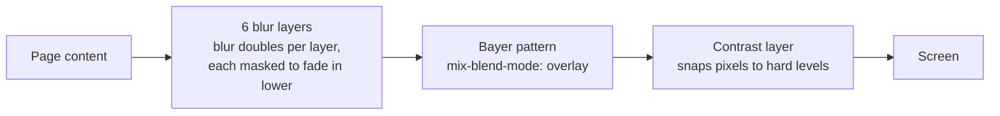

# Dither Blur

An experimentation project: a progressive blur with an ordered dither pattern at the bottom of the viewport, applied to live page content.

<!-- demo video: on github.com, edit this file and drag the .mp4 here, replacing this comment -->

## How it works

Eight fixed layers sit at the bottom of the screen. Each one reads what is painted behind it with `backdrop-filter`.



- Blur and dither grow toward the bottom edge.
- The layers are clipped at the footer and fade out once it is in view.
- Nothing is snapshotted, so animations stay live under the effect.

## Usage

```html
<link rel="stylesheet" href="dither-blur.css">
<script type="module">
  import { ditherBlur } from './dither-blur.js';
  ditherBlur({ stopAt: 'footer' });
</script>
```

Tune with CSS variables:

```css
:root {
  --dither-blur-height: 25vh;
  --dither-blur-radius: 40px;
  --dither-blur-dot: 3px;
  --dither-blur-contrast: 12;
}
```

Run the demo with any static server, for example `npx serve`.

## Browser support

Tested on Firefox and Chrome. Safari was not tested.
